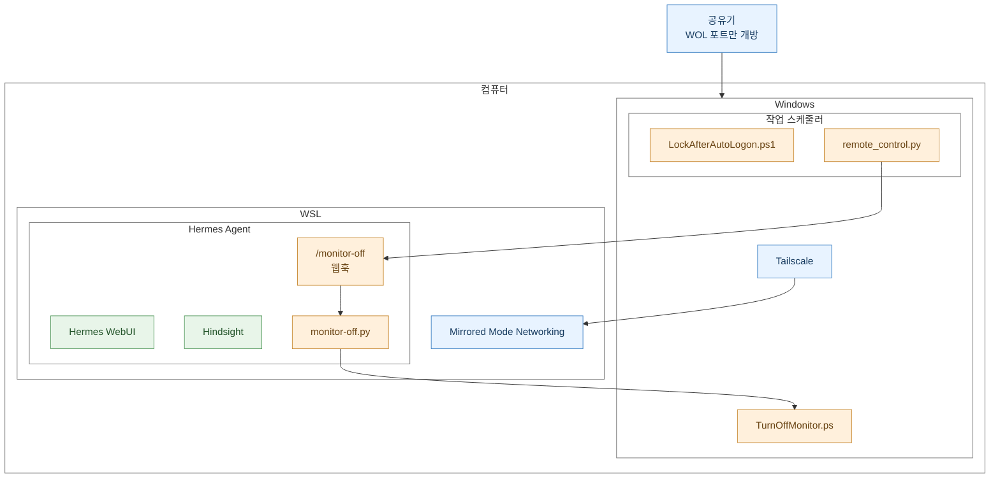

## 전체 구조

## 네트워크

저소음 미니PC가 아니라 소음이 있는 일반 데스크탑이기 때문에 잘 때는 꺼야 한다. 그래서 켜고 끄는 것에 신경을 많이 썼다. 

다른 모든 외부접속은 Tailscale을 사용하되, 외부에서도 필요할 때 컴퓨터를 켤 수 있도록 WOL 포트는 개방했다.

WSL은 네트워크 미러모드 설정으로 윈도우의 Tailscale을 공유한다.

## LockAfterAutoLogon.ps1

WSL은 윈도우의 특정 사용자 세션에 종속되어 있기 때문에 로그인 없이 실행되지 않는다. 시스템 서비스와 백그라운드를 담당하는 ‘세션0’이 대신 실행해줄 수가 없는 것이다. 

그래서 마이크로소프트가 배포하는 Autologon.exe 로 자동 로그인을 설정하고, 로그인 시에 작업스케줄러를 통해 WSL이 실행되도록 설정했다.

로그인 절차가 완료되기 전에 화면을 잠그고 바로 해제하면 아직 자격증명이 남아있기 때문에 비밀번호를 묻지 않는 현상이 발생한다. 

**`LockAfterAutoLogon.ps1`** 는 로그인 시에 작업스케줄러를 통해 실행된다. `LogonUI.exe` 프로세스가 종료되는 것을 감지하여 로그인 절차가 완료된 것을 확인한 뒤에 화면을 확실하게 잠그는 역할을 한다.

## remote_control.py

**`remote_control.py`** 는 헤르메스 설치 이전부터 존재하던 컴퓨터 원격 종료 스크립트다. 여기에 모니터 끄기 기능을 추가해봤으나 작동하지 않았다. 작업스케줄러에서 백그라운드로 실행되어 ‘세션 0’에 격리되어 있기 때문에 윈도우 사용자 세션의 UI를 조작할 수가 없는 것이다. 

어떻게든 `remote_control.py` 에서 모니터를 끄고 싶었기 때문에 헤르메스의 웹훅을 응용하여 우회하는 방법을 찾아냈다. 

`remote_control.py` 에 접속해서 모니터 끄기 버튼을 누르면 헤르메스의 `/monitor-off` 웹훅을 요청한다. 헤르메스의 웹훅은 스크립트를 실행할 수 있고, 프롬프트를 반환하지 않으면 모델 호출이 생략된다. 

`/monitor-off` 웹훅은 `monitor-off.py` 를 실행하고 비용 발생 없이 종료된다. 그리고 `monitor-off.py` 가 `TurnOffMonitor.ps` 를 실행해서 모니터를 끈다. 

이 과정에서 10초 정도 지연이 발생하는데, 어디에서 늘어지는지 찾고 싶었지만 아쉽게도 알 수 없었다.
